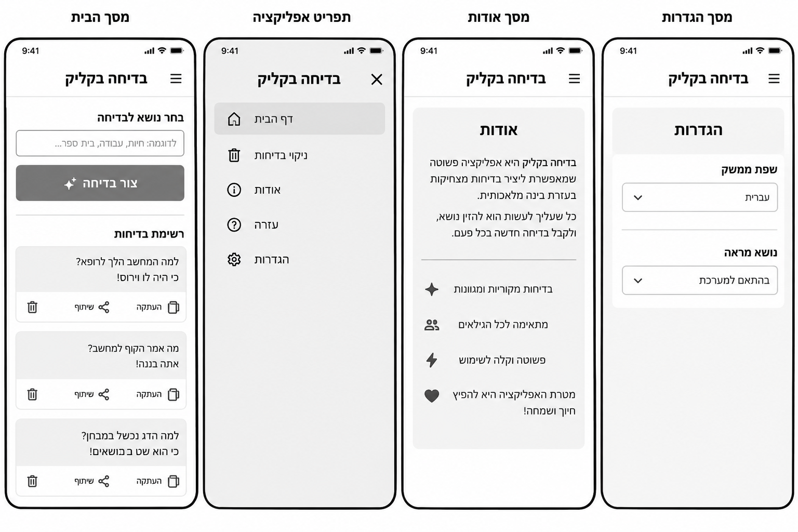
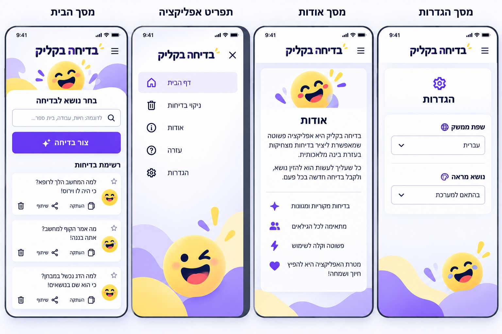
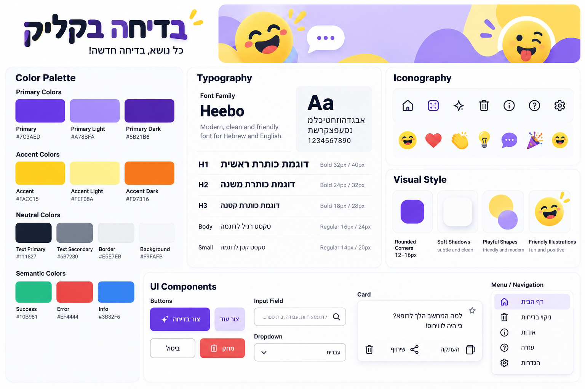

# DESIGN – בדיחה בקליק

## מקורות ועקרון קדימות

מסמך זה מתאר את המימוש החזותי לפי ה-Wireframes, ה-Style Guide וה-Mockups. **ה-PRD הוא המקור המחייב להיקף ולפונקציונליות.** יש אי-התאמה מהותית: ה-PRD מגדיר מסך ראשי יחיד, בעוד התמונות מציגות גם תפריט אפליקציה, מסך אודות ומסך הגדרות. מסכים אלה מתועדים להלן כדי לשקף נאמנה את התמונות, אך **אינם דרישות מוצר מאושרות ואין לממשם ללא עדכון ה-PRD**. בדומה לכך, בחירת שפת ממשק/נושא מראה, מסך עזרה, סימון מועדפים ואייקון חיפוש מופיעים בחומר החזותי אך אינם פיצ'רים מאושרים. שפת הממשק המחייבת היא עברית בלבד.

## 1. Screens – מסכי האפליקציה

### Wireframes

### Mockups

### 1.1 מסך הבית — מסך המוצר המאושר

- **מטרה:** יצירת בדיחה לפי נושא אופציונלי וצפייה ברשימת הבדיחות שנוצרו.
- **מבנה ותוכן:** כותרת המוצר "בדיחה בקליק" בחלק העליון; אזור "בחר נושא לבדיחה" עם שדה טקסט, דוגמה לנושאים וכפתור ראשי "צור בדיחה"; מתחתיו כותרת "רשימת בדיחות" וכרטיסים אנכיים לכל בדיחה. בכל כרטיס טקסט בדיחה ופעולות "העתקה", "שיתוף" ומחיקה. במובייל התוכן מסודר בעמודה אחת וניתן לגלילה. השדה והכפתור נשארים מעל הרשימה.
- **פעולות וניווט:** לחיצה על "צור בדיחה" מוסיפה כרטיס חדש בראש הרשימה, מעל הקודמים. אפשר להעתיק, לשתף או לבקש מחיקה של בדיחה; "ניקוי בדיחות" מוחק את הרשימה לאחר אישור. בקשת אישור מחיקה היא Dialog ולא מסך נוסף. מצבי טעינה, שגיאה ו-Offline הם מצבים של אותו מסך בלבד.
- **הערת התאמה:** ב-Wireframes מופיע "ניקוי בדיחות" בתוך תפריט; ב-PRD הפעולה מאושרת אך התפריט אינו מאושר. יש לחשוף את הפעולה במסך הראשי ללא הוספת מסך או תפריט ניווט חדש. כוכבי המועדפים והאימוג'ים המופיעים ב-Mockups אינם מגדירים פונקציונליות חדשה.

### 1.2 תפריט אפליקציה — מופיע בתמונות בלבד, לא מאושר ב-PRD

- **מטרה חזותית:** ריכוז קישורים ופעולות בתפריט צד.
- **מבנה ותוכן:** כותרת המוצר, כפתור סגירה, שורות עם אייקונים עבור "דף הבית", "ניקוי בדיחות", "אודות", "עזרה" ו"הגדרות".
- **פעולות וניווט המוצגים בתמונה:** חזרה לבית, ניקוי בדיחות ומעברים למסכים אחרים. **אין לממש ניווט זה במסגרת היקף ה-PRD הנוכחי.**

### 1.3 מסך אודות — מופיע בתמונות בלבד, לא מאושר ב-PRD

- **מטרה חזותית:** הצגת תיאור קצר של האפליקציה.
- **מבנה ותוכן:** כותרת עליונה, כרטיס תוכן מרכזי, איור אימוג'י, כותרת "אודות", פסקאות קצרות ואייקונים המלווים משפטי הסבר.
- **פעולות וניווט:** התמונה מציגה אייקון תפריט עליון; אין מסלול ניווט מאושר למסך זה.

### 1.4 מסך הגדרות — מופיע בתמונות בלבד, לא מאושר ב-PRD

- **מטרה חזותית:** הצגת אפשרויות תצורה.
- **מבנה ותוכן:** כותרת "הגדרות" וכרטיס עם Dropdown עבור "שפת ממשק" ו"נושא מראה".
- **פעולות וניווט:** בחירות התצורה מופיעות בתמונות אך **אינן מאושרות**. אין להוסיף שינוי שפת UI או Theme: ה-PRD קובע ממשק עברי וסטייל חזותי יחיד.

### מבנה הניווט

לפי ה-PRD, כל הפעולות המרכזיות מתבצעות **במסך הבית היחיד**, ללא ניווט בין עמודים. התמונות מציגות תפריט ועמודים נוספים כרפרנס חזותי בלבד. אין להמיר אותם ל-Routes עד שיאושרו בדרישות המוצר.

## 2. Style Guide – השפה העיצובית

### 2.1 Color Palette

הערכים להלן מועתקים מהתוויות הגלויות ב-Style Guide:

| שימוש | Token | HEX |
|---|---|---|
| צבע פעולה מרכזי | Primary | `#7C3AED` |
| גוון בהיר | Primary Light | `#A78BFA` |
| גוון כהה | Primary Dark | `#5B21B6` |
| צבע משלים | Accent | `#FACC15` |
| גוון משלים בהיר | Accent Light | `#FEF08A` |
| גוון משלים כהה | Accent Dark | `#F97316` |
| טקסט ראשי | Text Primary | `#111827` |
| טקסט משני | Text Secondary | `#6B7280` |
| קווי הפרדה | Border | `#E5E7EB` |
| רקע | Background | `#F9FAFB` |
| הצלחה | Success | `#10B981` |
| שגיאה | Error | `#EF4444` |
| מידע | Info | `#3B82F6` |

הכפתור הראשי סגול; צהוב וסגול בהיר משמשים להדגשה ולאיורים. רקעים וכרטיסים בהירים, טקסט כהה. יש לבדוק ניגודיות של כל צירוף בפועל בהתאם ל-WCAG 2.2 AA; צבעוניות ה-Mockup אינה הוכחה לעמידה בתקן.

### 2.2 Typography

- **Font Family:** `Heebo`, עם fallback מתאים ל-`sans-serif`; מיועד לעברית ולאנגלית.
- **H1:** Bold, `32px` / `40px` line-height.
- **H2:** Bold, `24px` / `32px`.
- **H3:** Bold, `18px` / `28px`.
- **Body:** Regular, `16px` / `24px`.
- **Small:** Regular, `14px` / `20px`.
- כותרת המוצר מודגשת ובולטת; תוויות שדות, כותרות מקטעים וכפתורים משתמשים במשקלים ברורים. יש לשמור על קריאות מלאה בהגדלת טקסט ובמסכים צרים.

### 2.3 UI Style

- **Buttons:** כפתור ראשי סגול בעל פינות מעוגלות וטקסט לבן; כפתורים משניים בגוון סגול בהיר; פעולה הרסנית יכולה להשתמש באדום כפי שמופיע ב-Style Guide. כפתור "צור בדיחה" הוא הפעולה הדומיננטית במסך.
- **Input Field:** שדה בהיר, מסגרת דקה בגוון Border, פינות מעוגלות, טקסט ו-placeholder מיושרים לימין. האייקון המופיע בדוגמה הוא חזותי בלבד, לא פונקציית חיפוש מאושרת.
- **Joke Cards:** כרטיסים לבנים עם פינות מעוגלות, הפרדה ומרווח אנכי; טקסט הבדיחה בחלק העליון ושורת פעולות בתחתית. לכל כרטיס אותן פעולות מאושרות. אין להוסיף כפתור מועדפים למרות סמל הכוכב בתמונות.
- **Menu / Navigation:** ב-Mockups מוצג תפריט עם אייקונים וטיפול פעיל בסגול בהיר; זהו רפרנס בלבד ולא רכיב למימוש בהיקף המאושר.
- **Dialogs / Status:** יש להשתמש באותה שפה חזותית עבור אישורי מחיקה, טעינה, שגיאה ו-Offline, מבלי ליצור מסכים נוספים. טקסטי הממשק המאושרים כוללים "מכינים לך בדיחה...", "לא הצלחנו ליצור בדיחה. נסו שוב." ו"נסו שוב".
- **Icons:** אייקוני Outline פשוטים לפעולות, לצד איורי אימוג'י משעשעים כאלמנטים חזותיים בלבד. אייקונים המשמשים ככפתורים מחייבים שם נגיש ומצב Focus ברור.

### 2.4 Visual Style

- **אווירה:** קלילה, שמחה, ידידותית למשפחה ומודרנית.
- **צורות:** עיגולים, כתמי צבע אורגניים, אלמנטים גליים ופינות מעוגלות.
- **Rounded Corners:** ב-Style Guide מצוין טווח אופייני של `12–16px` לרכיבים; באיורים ובאלמנטים דקורטיביים ייתכנו צורות עגולות יותר.
- **Shadows:** צללים רכים ועדינים להפרדת כרטיסים ורכיבים מהרקע.
- **Spacing:** ריווח עקבי ונדיב בין אזורי הטופס, כותרת הרשימה וכרטיסי הבדיחות; לא הוגדרה סקאלת Spacing מספרית במקורות ולכן אין לקבוע אותה כדרישה קשיחה.
- **Layout:** Mobile-first, טור מרכזי יחיד במסך צר; במחשב התאמת רוחב התוכן תוך שמירה על היררכיית הטופס והרשימה. התמונות מציגות Viewport של Smartphone; אין בהן Mockup מאושר למחשב.
- **Illustrations:** דמויות אימוג'י צוחקות בצהוב, כתמי סגול/לילך ונגיעות צהוב. להשתמש בהם באופן מרוסן כדי שלא יסתירו טקסט או פעולות.

### 2.5 שפה וכיווניות

- שפת ממשק קבועה: **עברית**, `dir="rtl"` ברמת הממשק.
- כותרות, תוויות, שדות, פעולות וכרטיסים מיושרים לימין בהתאם לתוכן; סדר רכיבי פעולה צריך להיות עקבי.
- בדיחות הנוצרות בשפה אחרת יוצגו בכיווניות מתאימה לתוכן (`dir="auto"` לאזור טקסט הבדיחה), ללא שינוי שפת ה-UI.
- טקסטי UI יישארו בעברית, גם אם המונחים הטכניים במסמך כתובים באנגלית.

## הערת יישום

**אין להסיק פיצ'רים מהתמונות בלבד.** בפרט, ארבע התצוגות שב-Wireframes וב-Mockups אינן משנות את החלטת ה-PRD על מסך מוצר יחיד. כדי לממש גם תפריט, אודות, עזרה, הגדרות או מועדפים יש לאשר שינוי מפורש ב-PRD לפני הפיתוח.
